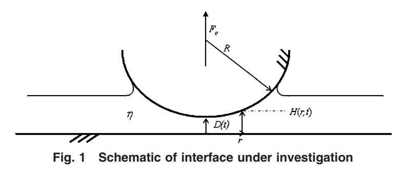
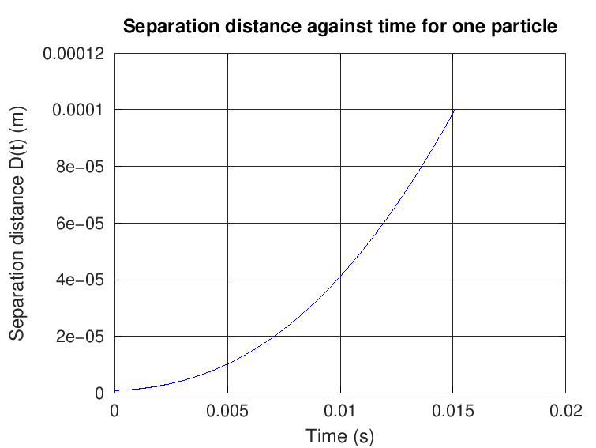
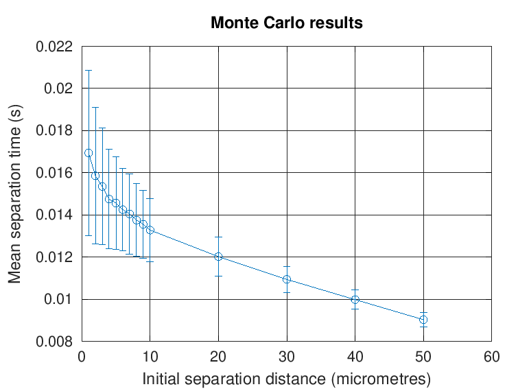

# Time for a flavour particle to be removed from a thin film of oil (MATLAB)

Project 3 from my Numerical Methods and Programming module. I updated to include my marker's feedback improvements.

## The problem

A flavour particle sits in a 0.1 mm film of oil on some food. When the food is flipped over, how long does it take for the particle to come completely out of the film?

A constant force F0 pulls the particle away from the surface, and the oil slows it down. The drag gets stronger the closer the particle is to the surface, because it's proportional to 1/D, where D is the gap. The particle has been removed once the gap is bigger than the film thickness.



Diagram from the module brief.

The equation of motion is

m dv/dt = F0 - (6 pi eta R^2 / D) v

where m = 0.74 g is the mass of the particle, R is its radius, eta is the viscosity of the oil, v is the velocity and F0 = 1 mN is the applied force.

## Methods

**Euler's method.** Starting from the initial gap D0 with v = 0, each time step h updates the velocity and the gap using their rates of change at the start of the step:

v_new = v + h dv/dt
D_new = D + h v

This repeats until D is bigger than the film thickness. I used h = 0.00001 s.

**Monte Carlo.** In reality the particle size and the viscosity vary, so one run isn't enough. For each of 14 starting gaps between 1 and 50 micrometres, I ran 1,000 trials, each with a random radius (uniform between 0.1 mm and 1 mm) and a random viscosity (normal, mean 0.2 Pa s, standard deviation 0.02 Pa s). That's 14,000 trials in total. The mean and standard deviation of the separation time are worked out for each starting gap.

## Files

- `separation_time.m`: Part A, one particle with a fixed radius (0.5 mm) and viscosity (0.2 Pa s), plotting the gap against time
- `monte_carlo.m`: Part B, the Monte Carlo simulation

## How to run

Put both files in the same folder and run in MATLAB:

```matlab
separation_time
monte_carlo
```

## Results

A single particle with a radius of 0.5 mm starting 1 micrometre from the surface takes about 0.015 s to come out of the film.



In the Monte Carlo simulation, the mean separation time falls from about 0.017 s for a particle starting 1 micrometre from the surface to about 0.009 s at 50 micrometres, and the spread between trials gets smaller too. With no drag at all, a particle starting at 1 micrometre would take about 0.012 s, so the drag adds around 40% when the particle starts very close to the surface, and matters much less further away.



## References

Numerical Methods and Programming lecture notes and project brief, University of Birmingham.
 
